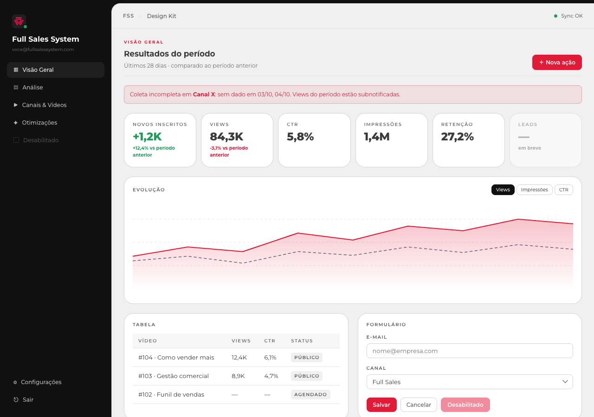

# FSS Design Kit

Sistema visual do dashboard **FSS YouTube Metrics**, empacotado para reutilizar em outros projetos.

**Vitrine ao vivo:** https://fernandaaliao-hue.github.io/fss-design-kit/preview.html

- `css/fss.css` — tokens + classes `.fss-*` + responsivo (funciona com ou sem Tailwind)
- `tailwind.config.js` — os mesmos tokens no Tailwind
- `components/` — `AppShell`, `ui.tsx` (KPI, modal, alertas…), `MetricChart`, `LoginScreen` (React + lucide-react + recharts)
- `preview.html` — vitrine estática

Guia completo (tokens, tipografia, componentes, responsivo e como aplicar): **[DESIGN.md](DESIGN.md)**
